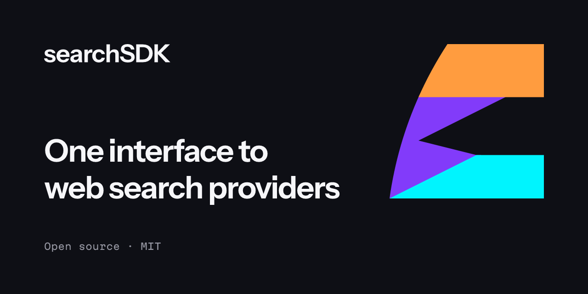

<p align="center">
  <a href="https://searchsdk.dev">
    
  </a>
</p>

<h1 align="center">searchSDK</h1>

<p align="center">
  <a href="https://github.com/Belweave/searchSDK/actions/workflows/ci.yml"></a>
  <a href="https://www.npmjs.com/package/@searchsdk/sdk"></a>
  <a href="LICENSE"></a>
</p>

<p align="center">
  <a href="https://searchsdk.dev/docs">Docs</a> ·
  <a href="https://searchsdk.dev/providers">Providers</a> ·
  <a href="https://searchsdk.dev/benchmarks">Benchmarks</a> ·
  <a href="CONTRIBUTING.md">Contributing</a>
</p>

searchSDK is an open-source, MIT-licensed SDK by Belweave that gives AI apps
and agents one interface to many web search APIs, with explicit fallback,
per-attempt cost and open benchmarks.

There are two calls: `search` and `contents`. Each provider is described
once, as data, in [`registry/`](registry). The TypeScript and Python runtimes
read that registry; neither contains provider-specific code.

**Tested against live production APIs.** Exa, TinyFish, Context.dev and
Firecrawl have been tested end to end against their production APIs through
`@searchsdk/sdk` across smoke checks, tuning and 4,848 live benchmark search
calls. Firecrawl (`search` and `contents`) has also passed formal per-vector
live conformance replay in both TypeScript and Python
([`registry/conformance/live/firecrawl-2026-11-25.json`](registry/conformance/live/firecrawl-2026-11-25.json)).
Brave Search, Perplexity and Tavily remain mapped from public documentation and
tested against synthetic fixtures only.

## Install

```sh
npm install @searchsdk/sdk
```

TypeScript and JavaScript, zero runtime dependencies, Node 24 or newer.

```ts
import { search } from "@searchsdk/sdk";

// Reads EXA_API_KEY from the environment.
const { results, cost } = await search("sqlite wal mode", { provider: "exa" });
console.log(results[0]?.title, results[0]?.url, cost.usd);
```

For fallback, retries and page text, create a client:

```ts
import { createClient } from "@searchsdk/sdk";

const client = createClient({ provider: "tavily", fallback: ["exa"], maxRetries: 1 });
const res = await client.search("eu ai act", { recency: "month", timeoutMs: 10_000 });
const pages = await client.contents(res.results.map((r) => r.url), { provider: "exa" });
console.log(res.attempts, pages.cost);
```

Every response carries its `cost` in USD (reported, estimated from list
prices, or `null` when unknown) and every `attempt`, each marked billed `yes`,
`possible` or `no`, so retries and fallback never hide spend. Failures throw
`SearchError` with a fixed `code`. Retries and fallback are off unless you
set them. Keep provider keys on the server. Full API: the
[TypeScript README](sdk/typescript/README.md) and
[searchsdk.dev/docs](https://searchsdk.dev/docs).

### Python

Python 3.10 or newer, standard library only. Not on PyPI yet; install from
source:

```sh
git clone https://github.com/Belweave/searchSDK
python -m pip install ./searchSDK/sdk/python
```

```python
import searchsdk

response = searchsdk.search("sqlite wal mode", provider="exa")
print(response.results[0].title, response.cost.usd)
```

See the [Python README](sdk/python/README.md).

## Providers

<!-- readme-providers:start (generated by scripts/readme-providers.mjs; do not edit) -->
| Provider | `provider` | `search` | `contents` | Live verification |
| --- | --- | :---: | :---: | --- |
| [Brave Search](https://searchsdk.dev/providers/brave) | `brave` | ✓ | — | unverified |
| [Context.dev](https://searchsdk.dev/providers/context) | `context` | ✓ | ✓ | unverified |
| [Exa](https://searchsdk.dev/providers/exa) | `exa` | ✓ | ✓ | unverified |
| [Firecrawl](https://searchsdk.dev/providers/firecrawl) | `firecrawl` | ✓ | ✓ | verified |
| [Perplexity](https://searchsdk.dev/providers/perplexity) | `perplexity` | ✓ | ✓ | unverified |
| [Tavily](https://searchsdk.dev/providers/tavily) | `tavily` | ✓ | ✓ | unverified |
| [TinyFish](https://searchsdk.dev/providers/tinyfish) | `tinyfish` | ✓ | ✓ | unverified |
<!-- readme-providers:end -->

Keys come from each provider's documented environment variable (for example
`EXA_API_KEY`) or are passed to the client. In the table above, `verified`
means every replayable conformance vector has passed against the live API in
both TypeScript and Python (`bench verify`); `unverified` means formal
per-vector live conformance has not run yet (Exa, Context.dev and TinyFish have
still been exercised live across smoke, tuning and 1,212+ benchmark calls each).
Provider names and logos are trademarks of their owners; searchSDK is not
affiliated with or endorsed by any provider.

## Benchmarks

searchSDK Benchmarks measures providers through the TypeScript runtime,
exactly as users call them. The method is version 0.4.0
([bench/METHOD.md](bench/METHOD.md)), and the live leaderboard is published at
[searchsdk.dev/benchmarks](https://searchsdk.dev/benchmarks).

First full live run (404 queries × 3 passes = 1,212 measured calls per
provider, default settings; 0 items dropped):

| Group | Provider | Known-answer [95% CI] | Usable | Latency p50 / p95 | Cost / query | Retest agree / URL overlap |
| --- | --- | --- | ---: | ---: | ---: | --- |
| `1=` | **Exa** | **95.7%** [93.8, 97.4] | 99.5% | 1,559 / 3,837 ms | $0.0070 | 98.3% / 0.78 |
| `1=` | **TinyFish** | **93.1%** [90.7, 95.3] | 99.7% | 1,417 / 3,066 ms | $0.0000\* | 97.8% / 0.65 |
| `2` | **Context.dev** | **86.2%** [83.5, 88.9] | 99.6% | 1,329 / 3,124 ms | $0.0020 | 91.6% / 0.43 |
| sep.\*\* | **Firecrawl** | **86.9%** [83.7, 90.0] | 98.7% | 425 / 5,331 ms\*\* | $0.0076 | 100.0% / 1.00 |

- **Paired main run** ([`bench/results/full-2026-12/`](bench/results/full-2026-12)):
  Exa, TinyFish and Context.dev ran together on the same 404 items ($11.12 cash).
  Scores within 6 points with overlapping paired bootstrap CIs share a rank
  group (`1=`). All providers kept default settings after tuning.
- **\*TinyFish cost:** $0.0000 inside its free daily allowance with paid
  overage disabled on the account.
- **\*\*Firecrawl separate run and caching**
  ([`bench/results/full-2026-12-firecrawl/`](bench/results/full-2026-12-firecrawl)):
  run on the same 404 items ~4 hours later on a Firecrawl credit grant. Pass 1
  cold latency p50 was **3,403 ms** (p95 6,084 ms), while Passes 2 and 3 dropped
  to **300–315 ms** with 100% URL overlap across passes, indicating server-side
  caching of repeated queries.
- **Judged relevance:** automated judge agreement was high (Kimi K3.1 Pro
  self-consistency κ = 0.94 main / 0.99 Firecrawl; cross-judge κ with DeepSeek
  V4.1 Flash = 0.91 / 0.94), but judged scores are **withheld** under
  `METHOD.md §6` until 100 blind human labels (`bench label`) verify
  judge–human agreement. Known-answer scores, reliability, latency and cost
  publish either way.
- Brave Search, Perplexity and Tavily have not been run yet. CI runs the
  harness on synthetic fixtures only.

## Repository

| Path | What |
| --- | --- |
| [`registry/`](registry) | Provider specs, named steps, shared policy and conformance vectors |
| [`sdk/typescript/`](sdk/typescript) | `@searchsdk/sdk`, the TypeScript runtime |
| [`sdk/python/`](sdk/python) | `searchsdk`, the Python runtime |
| [`bench/`](bench) | The benchmark harness, datasets and method |
| [`site/`](site) | [searchsdk.dev](https://searchsdk.dev): Next.js and Fumadocs |
| [`brand/`](brand) | Brand sources, exports, tokens and fonts |
| [`docs/`](docs) | An index of the docs, and the [release guide](docs/releasing.md) |
| [`scripts/`](scripts) | Repository checks |

Each package installs and checks on its own. From the root, `npm run setup`
installs them all and `npm run check` runs every check CI runs. No check
needs a provider key or calls a provider.

## Earlier version

v1, the twelve-language SDK family, is archived at tag
[`v1-final`](https://github.com/Belweave/searchSDK/tree/v1-final) and branch
[`v1`](https://github.com/Belweave/searchSDK/tree/v1). It is not maintained.

## More

- [Documentation](https://searchsdk.dev/docs), also as
  [llms.txt](https://searchsdk.dev/llms.txt)
- [Contributing](CONTRIBUTING.md)
- [Security policy](SECURITY.md)
- [Third-party notices](THIRD_PARTY_NOTICES.md)
- [MIT license](LICENSE)

Provider services, their content and their terms remain the providers' own.
