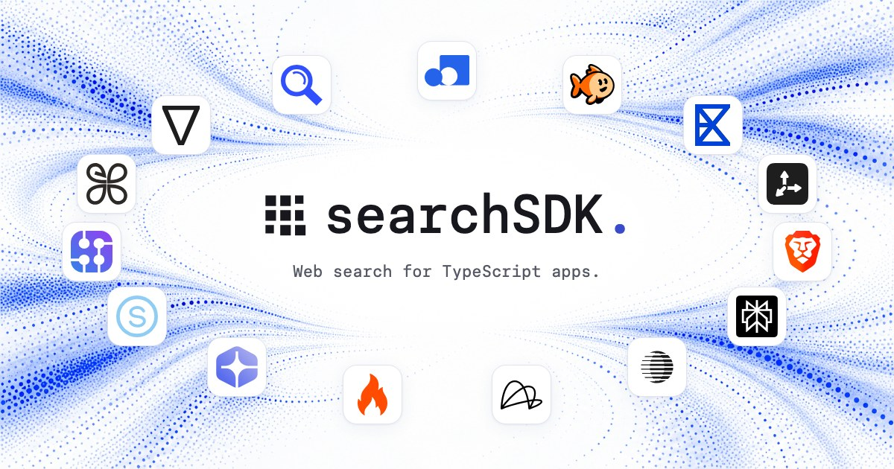

<p align="center">
  <a href="https://searchsdk.dev">
    
  </a>
</p>

<h1 align="center">searchSDK</h1>

<p align="center">
  Typed search across providers. Explicit fallback. Sources you can trace.<br />
  Built by <a href="https://belweave.com">Belweave</a>.
</p>

<p align="center">
  <a href="https://github.com/Belweave/searchSDK/actions/workflows/ci.yml"></a>
  <a href="LICENSE"></a>
  <a href="packages/sdk/package.json"></a>
  <a href="https://github.com/Belweave/searchSDK/commits/main/"></a>
</p>

<p align="center">
  <a href="https://searchsdk.dev/docs">Documentation</a> ·
  <a href="https://searchsdk.dev/playground">Try the playground</a> ·
  <a href="packages/sdk/README.md">SDK reference</a> ·
  <a href="CONTRIBUTING.md">Contribute</a>
</p>

searchSDK gives server-side TypeScript apps one web-search contract while keeping
provider choice visible. Use normalized results for retrieval, provider-native
clients for specialized operations, and deterministic mocks for local development.
The SDK is ESM with TypeScript declarations and zero runtime dependencies.

**Alpha. The package is not yet published to npm.** Install from a built checkout
or the release tarball below. APIs may change before a stable release.

## Start without API keys

Use the Node version in [.nvmrc](.nvmrc), then build the SDK from this repository:

```sh
git clone https://github.com/Belweave/searchSDK.git
cd searchSDK
nvm use
npm ci
npm run build:sdk
```

Create `example.mjs` at the repository root and run it with `node example.mjs`:

```js
import { createSearch } from '@belweave/search-sdk';
import { createMockProvider } from '@belweave/search-sdk/testing';

const search = createSearch({ provider: createMockProvider() });
const response = await search.web.search({ query: 'SQLite write concurrency', limit: 3 });

console.log(response.results);
console.log(response.attempts);
```

The mock returns local fixtures and makes no provider requests. To explore the
docs and fixture playground locally, run `npm run dev` and open the URL Vite prints.

To use the SDK in another server application:

```sh
# In this repository, after building:
npm pack -w @belweave/search-sdk

# In your application, install the generated file:
npm install /path/to/belweave-search-sdk-0.1.0-alpha.0.tgz
```

Download the [alpha tarball and SHA-256 checksum](https://github.com/Belweave/searchSDK/releases/tag/v0.1.0-alpha.0),
then install it with `npm install ./belweave-search-sdk-0.1.0-alpha.0.tgz`.
An npm registry installation will be documented after publication.

## Choose your provider and fallback

```ts
import { createSearch } from '@belweave/search-sdk';
import { context } from '@belweave/search-sdk/context';
import { tinyfish } from '@belweave/search-sdk/tinyfish';

const search = createSearch({
  provider: context({ apiKey: process.env.CONTEXT_API_KEY! }),
  fallback: [tinyfish({ apiKey: process.env.TINYFISH_API_KEY! })],
  timeoutMs: 10_000,
  attemptTimeoutMs: 4_000,
});

const response = await search.web.search({ query: 'SQLite write concurrency', limit: 5 });
console.log(response.provider, response.results, response.attempts);
```

Run real adapters on your server. This example sends provider requests and may
incur charges. Keep keys out of browser code, public environment variables, and
committed files.

## Search a batch

```ts
const outcomes = await search.web.searchBatch([
  { query: 'SQLite write concurrency', limit: 3 },
  { query: 'PostgreSQL transaction isolation', limit: 3 },
], { concurrency: 4, timeoutMs: 10_000 });

for (const outcome of outcomes) {
  if (outcome.status === 'fulfilled') console.log(outcome.index, outcome.value.results);
  else console.error(outcome.index, outcome.error.code);
}
```

Outcomes keep input order, and an individual failure preserves successful sibling
results. Worker concurrency is bounded; a shared deadline or `signal` also stops
queued items. Each dispatched search retains the client's provider and policies.
See the [batch search guide](docs/batch-search.md) for cancellation and outcome handling.

## What you control

- **Provider choice.** Fallback is explicit. Authentication failures, invalid
  responses, and empty results do not silently route to another provider.
- **Reliability policies.** Retries, bounded concurrency, caching, and in-flight
  deduplication are configurable; retries, caching, and sharing are opt-in.
- **Traceable results.** Source URLs, provider attribution, retrieval timestamps,
  and attempt traces stay attached. Scores retain each provider's native scale.
- **Native capabilities.** Thirteen native clients preserve documented operations
  and fields, including extraction, research, streaming, and job management where
  the provider exposes them.
- **Resumable work.** Durable checkpoints retain remote job IDs. Ambiguous
  submissions require reconciliation; remote effects have no exactly-once guarantee.
- **Key-free tests.** Inject transports or use deterministic mocks. Fixtures and
  declaration checks validate SDK contracts, not live account access or billing.

## Providers

Fifteen providers are represented: fourteen normalized web-search adapters and
thirteen provider-native clients. Provider access, filter support, and result
limits differ; consult the [provider reference](https://searchsdk.dev/docs/providers).

| Provider | Normalized web search | Provider-native client |
| --- | :---: | :---: |
| Context.dev | ✓ | ✓ |
| TinyFish | ✓ | ✓ |
| Exa | ✓ | ✓ |
| Tavily | ✓ | ✓ |
| Brave | ✓ | ✓ |
| Perplexity | ✓ | ✓ |
| Parallel | ✓ | ✓ |
| Linkup | ✓ | ✓ |
| Firecrawl | ✓ | ✓ |
| You.com | ✓ | ✓ |
| Serper | ✓ | ✓ |
| SerpAPI | ✓ | ✓ |
| Valyu | ✓ | — |
| SearXNG | ✓ | — |
| WonderSearch.ai / .com | — | ✓ |

WonderSearch searches a corpus through its native client. SearXNG connects to an
operator-selected instance with JSON search enabled. Valyu and SearXNG currently
provide normalized adapters only.

Authenticated live-provider validation and comparative benchmarks are pending.
The playground uses fixtures; it does not establish provider performance,
availability, or account-gated behavior.

## Find your next step

- [SDK quickstart and policies](packages/sdk/README.md): installation, fallback,
  native clients, cancellation, and durable operations.
- [Online documentation](https://searchsdk.dev/docs): request contracts, provider
  limits, and guides.
- [Contributing](CONTRIBUTING.md): local checks and reproducible provider changes.
- [Security policy](SECURITY.md): private reporting and integration boundaries.

The repository contains the SDK in `packages/sdk` and the static React/Vite docs
and fixture playground in `apps/web`. Run `npm run check` for SDK tests, type
checks, static-site checks, and packed-consumer verification. The CI workflow runs
these checks without provider credentials. It does not publish packages or deploy.

## License

[MIT](LICENSE). Provider services, credentials, content, and third-party assets
remain subject to their respective terms and licenses.
