# searchSDK brand guidelines

The rules for every surface that carries the name. Values live in `tokens.json`; `npm run check`
enforces the colour, contrast, copy and freshness rules marked **checked**.

## Concept

Signal and spectrum. Sources arrive as bands of colour and meet in one beam: apricot and cyan are
the sources, violet is where they meet, and the cut is the beam.

## Mark

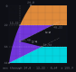

| Part | Construction (64-unit grid) |
| --- | --- |
| Box | 64 × 64. Right edge straight; every corner sharp. |
| Bands | apricot 0–22, beam 22–46, cyan 46–64 (11 : 12 : 9) |
| Left edge | one circular arc through 24,0 · 12,22 · 0,64 (radius 155.9) |
| Beam | apex 12,40, directly below the arc at 12,22. Upper edge rises 1:2 to 48,22; lower edge falls 1:4 to 36,46. |
| Cyan edge | 1:2 from 0,64 to 36,46, parallel to the beam's upper edge, so the violet band is as deep as the cyan (18). |
| Seams | violet is drawn first and runs one unit under its neighbours; shared edges never show a hairline. |

Two masters, one construction:

- **Main** (`src/mark/mark-*.svg`): band edges land on whole pixels at 32 px and every multiple of 32.
- **Small** (`src/mark/mark-small-*.svg`): a 16-unit grid with bands 6 : 6 : 4, apex 3,10. Use below 32 px and at 48 px.

Versions: `-dark` (for dark surfaces), `-light` (for light surfaces), `-mono` (`currentColor`, one colour).

## Wordmark and lockups

- Name: `searchSDK`, one word, lower-case `search`, capital `SDK`. Never retyped: use the outlines.
- Face: Instrument Sans, weight 650, width 100, tracked −20/1000 em; the r–c pair closed by a further 12/1000 em.
- **Horizontal**: x-height = the beam (24 u); baseline on the cyan's top edge; gap to the mark = the cyan band (18 u).
- **Stacked**: cap height = the beam (24 u); gap below the mark = 18 u; mark centred on the wordmark.
- **Icon only**: the mark alone.
- Lockup files (`src/lockup/`) include their clear space; mark and wordmark files are tight.

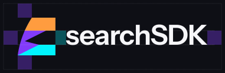

| Rule | Value |
| --- | --- |
| Clear space | the beam, 3/8 of the mark's height, on every side |
| Minimum, mark | 16 px (small master) |
| Minimum, horizontal lockup | mark 20 px tall |
| Minimum, stacked lockup | mark 40 px tall |
| Print minimum | mark 6 mm |

Backgrounds: the colour mark sits on `ink` 700–1000 (dark version) or `paper` (light version). On
any other colour, photograph or brand colour, use the single-colour mark in white or `ink-900`, or
the app icon tile.

## Colour

| Brand | Dark surfaces | Light surfaces | Role |
| --- | --- | --- | --- |
| Apricot | `#FF9C3F` oklch(0.78 0.16 60) | `#F3821D` oklch(0.72 0.17 55) | top band; the one primary action |
| Violet | `#823BFA` oklch(0.56 0.26 293) | `#823BFA` | middle band; selection; focus on light |
| Cyan | `#00F4FE` oklch(0.88 0.15 200) | `#00C0D7` oklch(0.74 0.13 210) | bottom band; focus on dark |

Neutrals: `ink` (hue 280, 50–1000; `ink-900` `#0E0F15` is the dark page) and `paper` (hue 85,
0–400; `paper-50` `#FAF9F6` is the light page). Roles (`surface-0…3`, `fg`, `fg-muted`, `accent`,
`ok`, `warn`, `danger`, `sample`, `code-*` and more) are in `tokens.json` and `tokens.css`; the same
values under the website's names are in `tokens.site.css`.

- Flat fills only. The three colours meet at hard edges; never blend them in a gradient.
- Brand colours never encode data. Provider hues never decorate.
- One apricot primary action per view.

**Provider hues** are not brand colours. Each provider keeps a hue derived from its own brand
colour, always shown with its logo and name, never alone. Their values belong to the website.

Contrast (WCAG 2), **checked** in both themes. Text ≥ 4.5, body text ≥ 7, non-text ≥ 3, mark bands ≥ 2:

<!-- contrast:start -->
| Pair | Dark | Light | Min |
| --- | --- | --- | --- |
| `fg` on `surface-0` | 17.73 | 18.16 | 7 |
| `fg` on `surface-1` | 16.85 | 18.82 | 7 |
| `fg` on `surface-2` | 15.52 | 17.10 | 7 |
| `fg-muted` on `surface-0` | 9.89 | 11.69 | 4.5 |
| `fg-muted` on `surface-1` | 9.40 | 12.11 | 4.5 |
| `fg-muted` on `surface-2` | 8.66 | 11.00 | 4.5 |
| `fg-subtle` on `surface-0` | 6.59 | 7.36 | 4.5 |
| `fg-subtle` on `surface-1` | 6.27 | 7.62 | 4.5 |
| `fg-subtle` on `surface-2` | 5.77 | 6.93 | 4.5 |
| `accent-text` on `surface-0` | 9.18 | 5.54 | 4.5 |
| `accent-text` on `surface-1` | 8.72 | 5.74 | 4.5 |
| `accent-text` on `surface-2` | 8.03 | 5.22 | 4.5 |
| `on-accent` on `accent` | 9.18 | 7.30 | 4.5 |
| `on-accent` on `accent-strong` | 11.48 | 5.79 | 4.5 |
| `ok` on `surface-0` | 12.39 | 5.58 | 4.5 |
| `warn` on `surface-0` | 10.68 | 5.62 | 4.5 |
| `danger` on `surface-0` | 7.12 | 5.77 | 4.5 |
| `sample` on `surface-0` | 13.89 | 5.65 | 4.5 |
| `ok` on `surface-2` | 10.84 | 5.25 | 4.5 |
| `warn` on `surface-2` | 9.35 | 5.29 | 4.5 |
| `danger` on `surface-2` | 6.23 | 5.44 | 4.5 |
| `sample` on `surface-2` | 12.15 | 5.32 | 4.5 |
| `on-state` on `ok` | 12.39 | 5.58 | 4.5 |
| `on-state` on `warn` | 10.68 | 5.62 | 4.5 |
| `on-state` on `danger` | 7.12 | 5.77 | 4.5 |
| `on-state` on `sample` | 13.89 | 5.65 | 4.5 |
| `code-keyword` on `well` | 8.88 | 5.98 | 4.5 |
| `code-string` on `well` | 13.50 | 5.37 | 4.5 |
| `code-number` on `well` | 11.39 | 5.43 | 4.5 |
| `code-function` on `well` | 12.25 | 5.84 | 4.5 |
| `code-type` on `well` | 10.11 | 5.88 | 4.5 |
| `fg-subtle` on `well` | 6.81 | 6.93 | 4.5 |
| `line-strong` on `surface-0` | 4.11 | 4.41 | 3 |
| `focus` on `surface-0` | 14.00 | 5.04 | 3 |
| `focus` on `surface-2` | 12.25 | 4.74 | 3 |
| `mark-violet` on `surface-0` | 3.60 | 5.04 | 2 |
| `mark-apricot` on `surface-0` | 9.18 | 2.48 | 2 |
| `mark-cyan` on `surface-0` | 14.00 | 2.09 | 2 |
<!-- contrast:end -->

## Type

| Role | Face | Licence |
| --- | --- | --- |
| Headings and prose | Instrument Sans (variable, weight 400–700) | SIL OFL 1.1 |
| Code, numbers, units, benchmark figures | Martian Mono (variable, weight 100–800, width 75–112.5) | SIL OFL 1.1 |

Instrument Sans replaces the site's Bricolage Grotesque: its straight-armed K repeats the mark's
cut, its flat terminals match the bands, and it stays plain at text sizes. Martian Mono is kept.

| Token | Size | Weight | Leading | Tracking |
| --- | --- | --- | --- | --- |
| `display` | clamp(3rem, 8.4vw, 7rem) | 650 | 0.94 | −0.035em |
| `h2` | clamp(2.25rem, 5vw, 4.25rem) | 650 | 1.04 | −0.022em |
| `3xl` / `2xl` / `xl` | clamp(2rem, 4.2vw, 3.25rem) / 1.75rem / 1.375rem | 600 | 1.3 | −0.022em |
| `lead` | clamp(1.125rem, 1.5vw, 1.375rem) | 400 | 1.6 | 0 |
| `base` / `sm` / `xs` | 1rem / 0.875rem / 0.75rem | 400 | 1.6 | 0 |
| `label` (mono) | 0.6875rem, width 87.5% | 500 | 1.3 | 0.06em |
| `readout` (mono) | clamp(2rem, 4vw, 3.25rem), tabular figures | 400 | 1.04 | 0 |

Sentence case everywhere. Numbers in mono with tabular figures and a unit.

## Voice

- The name is always `searchSDK`. **Checked.**
- Say what it does, in plain words. One idea per sentence.
- Word caps: hero 30, home page 150, docs page 300 outside code, social card 8 per headline. README files 200. **Checked** for this folder.
- Banned words: <!-- lint-ignore --> seamless, effortless, revolutionary, powerful, unlock, supercharge, game-changing, next-level, blazing, lightning-fast, cutting-edge, world-class, best-in-class, magic, ultimate, robust. **Checked.**
- Every claim is backed where it is made: a benchmark figure links its run, date and method; a provider capability links its source.
- Sample data carries a `Sample data` tag; an unverified fact carries `Unverified`. Fixture results are never called live results.

## Motion

Motion shows data arriving and state changing. It never decorates still content.

| Token | Value | Use |
| --- | --- | --- |
| `instant` / `fast` / `base` | 80 / 140 / 220 ms | press, hover, small state changes |
| `slow` / `reveal` | 400 / 640 ms | panels, content entering |
| `settle` | 1000 ms | numbers and bars settling on real values |
| `stagger` | 60 ms | between items entering together |
| `enter` | cubic-bezier(0.16, 1, 0.3, 1) | anything arriving |
| `exit` | cubic-bezier(0.7, 0, 0.84, 0) | anything leaving |
| `standard` | cubic-bezier(0.2, 0, 0, 1) | everything else |

- May move: results and figures as they arrive, state, focus, the mark in a loading state or once in the header.
- Never moves: provider logos, body text after it is read, the mark inside content.
- Direction: sources travel right to left, into the beam.
- Reduced motion: every duration becomes 0.01 ms and every loop stops on its finished frame. **Required.**

Study: `src/motion/mark-loader-*.svg` (loop, 2400 ms) and `src/motion/mark-intro-*.svg` (once, 600 ms), each `-dark` and `-light`.
The bands flow in from the right, violet last through the beam, hold, and flow out left.

## Provider logos and trademarks

- Use each provider's official files, unmodified, under that provider's own rules, with the source recorded.
- Never recolour, redraw, animate, crop or add effects to a provider logo, and never set it larger than the searchSDK mark.
- Logos identify providers in comparisons. They never imply endorsement, partnership or affiliation.
- Every page that names providers says the names are trademarks of their owners and that searchSDK is not affiliated with them.

## Never

| | | | |
| --- | --- | --- | --- |
| 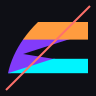 stretch | 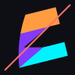 rotate | 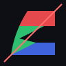 recolour | 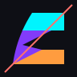 reorder the bands |
|  gradient | 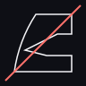 outline | 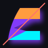 glow, shadow, blur | 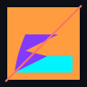 colour mark on a brand colour |
|  crop | 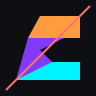 redraw or simplify | 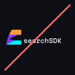 retype the wordmark |  change the name |
